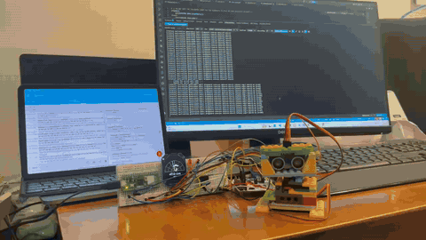
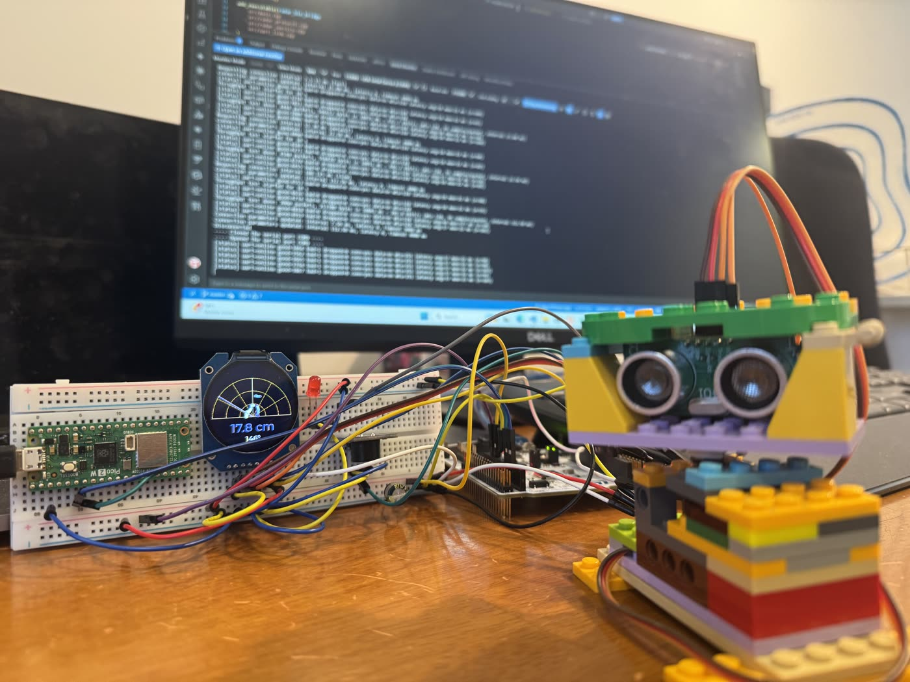
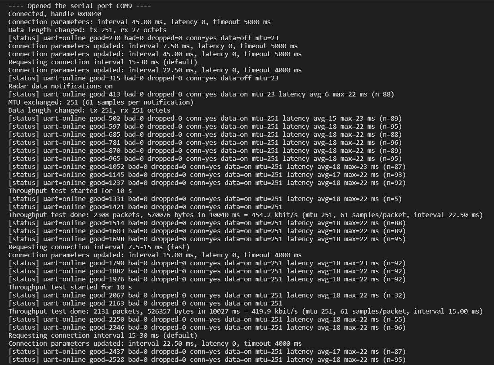

# Radar BLE Bridge

A Bluetooth Low Energy bridge for the [desktop radar](../desktop_radar):
a Raspberry Pi Pico 2 W receives radar frames from the STM32 Nucleo over
UART, validates them and forwards them to a phone over a custom GATT
service.





```
Nucleo-F446RE (Zephyr)  --UART 115200-->  Pico 2 W (BTstack)  --BLE GATT-->  Phone (nRF Connect)
   servo + ultrasonic                       CYW43439                         later: Qt radar_host
```

## Status

| Phase | Content | State |
| --- | --- | --- |
| 1 | BTstack bring-up: advertise custom service, heartbeat notify | Done |
| 2 | Radar data over GATT: UART frames, batching, threshold write, link status | Done |
| 3 | Robustness and performance: reconnect, UART loss detection, MTU, connection parameters, measurements | Done |
| 4 | Security: LE Secure Connections pairing, bonding, encrypted writes | Planned |
| 5 | Optional: BLE transport in the Qt host app | Planned |

Problems met and how they were solved are logged in [docs/DEVLOG.md](docs/DEVLOG.md).

## Hardware

| Nucleo-F446RE | | Pico 2 W |
| --- | --- | --- |
| A0 (PA0, UART4 TX) | → | GP5 (pin 7, UART1 RX) |
| A1 (PA1, UART4 RX) | ← | GP4 (pin 6, UART1 TX) |
| GND | — | GND (pin 8) |

Both boards use 3.3 V logic. The Pico is powered from its own USB port,
which also carries its log output (USB serial).

## GATT

Custom 128-bit UUIDs share the base `F5D3xxxx-3515-47D6-879D-3E34DE8F197A`.
The device advertises as `RadarBLE` with the service UUID in the
advertising data. All multi-byte values are little-endian.

| UUID | Name | Properties |
| --- | --- | --- |
| `F5D30001-…` | Radar Bridge service | |
| `F5D30002-…` | Radar Data | Notify |
| `F5D30003-…` | Alarm Threshold | Read, Write |
| `F5D30004-…` | Link Status | Read, Notify |
| `F5D30005-…` | Test Control | Write |

### Radar Data (notify)

Samples are batched: a notification is sent when it is full for the
current MTU, or when its oldest sample is 20 ms old (an exact one-shot
timer, not a polling tick). See docs/DEVLOG.md for why 100 ms was cut to 20 ms.

| Offset | Size | Field |
| --- | --- | --- |
| 0 | 2 | Sequence number, +1 per notification (gaps = lost packets) |
| 2 | 1 | Sample count n |
| 3 + 4i | 1 | Angle, degrees (0-180) |
| 4 + 4i | 1 | Status: 0 OK, 1 out of range, 2 no sensor reply |
| 5 + 4i | 2 | Distance, mm (0 unless status is 0) |

Up to (MTU - 6) / 4 samples per notification: 4 at the default MTU of
23, 61 at MTU 251.

### Alarm Threshold (read, write)

| Offset | Size | Field |
| --- | --- | --- |
| 0 | 2 | Warn distance, mm |
| 2 | 2 | Danger distance, mm |

A write must be 4 bytes with 20 <= danger < warn <= 4500. It is relayed
to the Nucleo, which applies it and reports back. Errors:

| ATT error | Meaning |
| --- | --- |
| 0x0D Invalid Attribute Value Length | Not 4 bytes |
| 0x13 Value Not Allowed | Out of range, or danger >= warn |
| 0x80 (application) | Radar UART link is offline |

A read returns the thresholds last reported by the Nucleo (zeros until
the first report).

### Link Status (read, notify)

Notified once a second, and immediately when the UART link state,
MTU or connection parameters change.

| Offset | Size | Field |
| --- | --- | --- |
| 0 | 1 | UART link online (valid frame within the last 1 s) |
| 1 | 4 | Good frames received |
| 5 | 4 | Bad frames (framing, checksum or field errors) |
| 9 | 4 | Samples dropped because the BLE link could not keep up |
| 13 | 2 | Connection interval, 1.25 ms units |
| 15 | 2 | Peripheral latency, connection events |
| 17 | 2 | Supervision timeout, 10 ms units |
| 19 | 2 | ATT MTU |

### Test Control (write)

| Bytes | Command |
| --- | --- |
| `01 <seconds>` | Throughput test: fill every Radar Data notification to the MTU with synthetic samples for 1-60 s (10 s if omitted). Requires Radar Data to be subscribed (else ATT error 0x81). Real samples pause during the test; the result is printed on the USB log |
| `00` | Stop the throughput test |
| `02` / `03` / `04` | Request a connection interval of 7.5-15 / 15-30 / 100-125 ms (latency 0, 4 s supervision timeout) |

About 2 s after connecting, the bridge requests 15-30 ms by itself. The
range follows Apple's accessory guidelines, so iOS and Android both
accept it.

### Measurements in the USB log

- Every 5 s the status line adds `latency avg/max`: the time from a
  radar frame arriving on the UART to its notification being accepted by
  BTstack (batching delay included). It covers the bridge only, not the air time, over the samples sent in that window.
- `Data length changed` shows the negotiated LE Data Length Extension.

## Results

Measured with an Android phone running nRF Connect, MTU 251 and LE Data
Length Extension (251 octets) negotiated, 61 samples per notification.

| Test | Connection interval | Result |
| --- | --- | --- |
| Throughput, 10 s | 22.5 ms | 2308 packets, 570,076 bytes = **454.2 kbit/s** |
| Throughput, 10 s | 15 ms | 2131 packets, 526,357 bytes = **419.9 kbit/s** |
| Throughput, earlier runs | 15-30 ms | 438-466 kbit/s at MTU 251; 156 kbit/s at MTU 23 |
| UART-to-notification latency, normal radar traffic | 22.5 ms | avg 17-18 ms, max 22-23 ms |
| UART frames | | 2500+ good, 0 bad, 0 dropped in this session |

Latency was about 120 ms with a 100 ms batching window. At the radar's
low data rate a notification rarely fills up, so most samples waited for
the timer; cutting the window to 20 ms brought the average to 18 ms
(details in docs/DEVLOG.md).

The shorter 15 ms interval gave lower throughput than 22.5 ms. A likely
reason is that the phone allows only a limited number of packets per
connection event, so more frequent but shorter events carry less data;
this has not been confirmed yet.

<details>
<summary>Bridge log for the run above</summary>


</details>

## UART protocol

Text frames `$<body>*<CS>\r\n`, CS = XOR of the body as two hex digits,
115200 8N1.

| Direction | Frame | Meaning |
| --- | --- | --- |
| Nucleo → bridge | `$R,<angle>,<distance_mm>,<status>` | Radar sample |
| Nucleo → bridge | `$A,<warn_mm>,<danger_mm>` | Thresholds in effect (at boot, and in reply to `T`/`Q`) |
| bridge → Nucleo | `$T,<warn_mm>,<danger_mm>` | Set thresholds |
| bridge → Nucleo | `$Q` | Query thresholds (sent when the link comes online) |

## Build and flash

Built with the Pico SDK 2.3 (not with Zephyr/west). The easiest route on
Windows is the Raspberry Pi Pico VS Code extension:

1. Import Project → this folder, SDK 2.3.0, board Pico 2 W
2. Compile → `build/radar_ble_bridge.uf2`
3. Hold BOOTSEL while plugging in USB, then copy the `.uf2` to the
   `RP2350` drive (or use Run)

Command line, with `PICO_SDK_PATH` and an ARM GNU toolchain set up:

```
cmake -G Ninja -B build
cmake --build build
```

## Tests

The UART frame parser has no SDK dependencies and is unit tested on a PC:

```
cd tests
g++ -std=c++20 -Wall -Wextra -I../src ../src/radar_protocol.cpp test_radar_protocol.cpp -o test_radar_protocol
./test_radar_protocol
```

## Project layout

```
├── CMakeLists.txt
├── pico_sdk_import.cmake   # copied from the Pico SDK
├── docs/DEVLOG.md          # problems and fixes per phase
├── tests/
│   └── test_radar_protocol.cpp
└── src/
    ├── main.cpp            # init and idle loop
    ├── radar_service.*     # advertising, GATT callbacks, batching, link status
    ├── uart_link.*         # UART1 IRQ ring buffer, line assembly in BTstack context
    ├── radar_protocol.*    # frame parsing/formatting (pure C++, unit tested)
    ├── radar_gatt.gatt     # GATT database (compiled to radar_gatt.h)
    └── btstack_config.h    # BTstack feature and buffer configuration
```